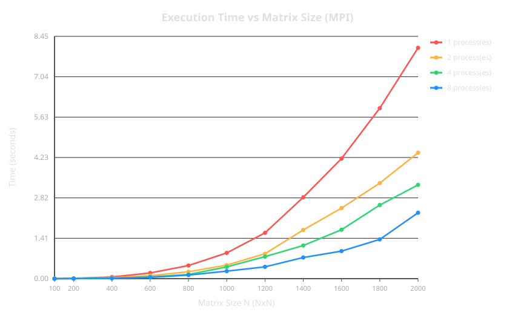
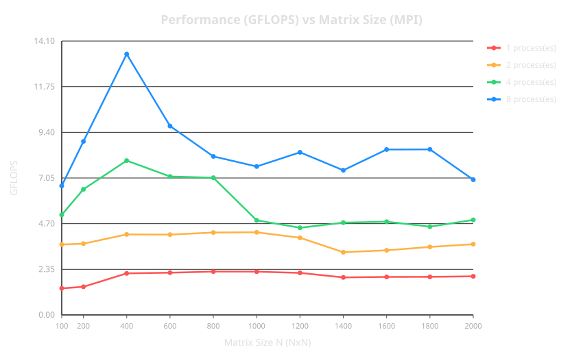
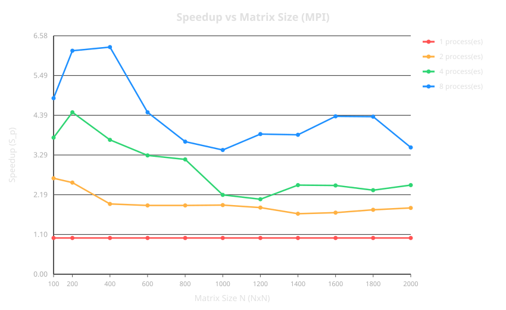
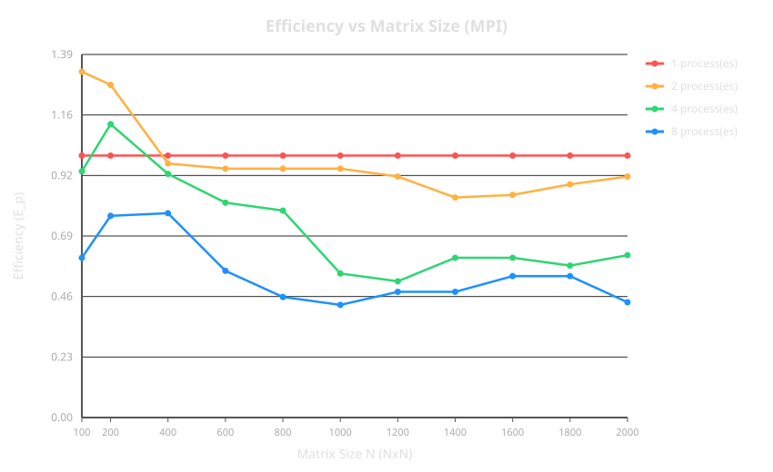

# Лабораторная работа №3: Параллельная версия умножения матриц с использованием MPI

## 1. Цель работы

Основная цель работы — модифицировать программу умножения квадратных матриц из Лабораторной работы №1 для поддержки параллельных вычислений на архитектурах с распределенной памятью с использованием технологии **MPI (Message Passing Interface)**. 

В рамках работы требовалось:
1. Реализовать алгоритм ленточной декомпозиции по строкам для распределения вычислительной нагрузки между процессами MPI.
2. Провести серию бенчмарков на суперкомпьютере **«Сергей Королёв»** для квадратных матриц различной размерности ($N \in [100, 2000]$) на различном числе процессоров/ядер ($P \in \{1, 2, 4, 8\}$).
3. Измерить время выполнения вычислений, рассчитать производительность в GFLOPS, показатели ускорения ($Speedup$) и эффективности ($Efficiency$).
4. Проанализировать полученные результаты с помощью визуализации графиков (`scripts/figures/mpi_time.svg`, `scripts/figures/mpi_gflops.svg`, `scripts/figures/mpi_speedup.svg`, `scripts/figures/mpi_efficiency.svg`).

---

## 2. Алгоритм и реализация

Для реализации параллельного умножения матриц $C = A \times B$ была выбрана **ленточная декомпозиция по строкам (Row-wise Striped Decomposition)**. Программа написана на языке C++ с применением библиотеки OpenMPI/MS-MPI и состоит из двух ключевых модулей: `matrix.hpp` и `main.cpp`.

### 2.1. Анализ структур данных и методов (`matrix.hpp`)

Класс `Matrix` инкапсулирует динамический одномерный вектор `std::vector<double> data` размерности $N \times N$, хранящий элементы матрицы в сплошном блоке памяти (Row-Major Order).

Ключевым методом вычислений является статическая функция `Matrix::multiply_strip`:

```cpp
static std::vector<double> multiply_strip(
    const std::vector<double>& local_A_rows, const Matrix& B,
    size_t num_rows) {
  size_t N = B.get_size();
  std::vector<double> local_C(num_rows * N, 0.0);
  const double* B_ptr = B.get_data_ptr();

  for (size_t i = 0; i < num_rows; ++i) {
    for (size_t k = 0; k < N; ++k) {
      double temp = local_A_rows[i * N + k];
      size_t row_i_offset = i * N;
      size_t row_k_offset = k * N;

      for (size_t j = 0; j < N; ++j) {
        local_C[row_i_offset + j] += temp * B_ptr[row_k_offset + j];
      }
    }
  }
  return local_C;
}
```

#### Особенности реализации:
* **Кэш-эффективный порядок циклов ($i-k-j$):** Во внутреннем цикле по $j$ обращение к массиву `B_ptr` и итоговой строке `local_C` происходит по последовательным адресам памяти (шаг по памяти равен 1 element). Это снижает количество промахов кэша (Cache Misses) и позволяет компилятору автоматически векторизовать внутренний цикл с использованием SIMD-инструкций (AVX2/AVX-512).
* **Снижение лишних обращений к памяти:** Временная переменная `temp` фиксирует значение $A_{i,k}$, избегая повторных выборок из оперативной памяти во внутреннем цикле по $j$.

---

### 2.2. Анализ схемы взаимодействия процессов (`main.cpp`)

Взаимодействие процессов построено по схеме **Master-Worker** с использованием коллективных операций MPI:

1. **Инициализация и распределение данных:**
   - Главный процесс (`rank == 0`) генерирует матрицы $A$ и $B$ случайными числами в диапазоне $[1.0, 10.0]$ с помощью ГПСЧ `std::mt19937` (seed 1337).
   - Все остальные процессы выделяют память под всю матрицу $B$.

2. **Рассылка матрицы $B$ (`MPI_Bcast`):**
   - Так как для умножения полосы строк матрицы $A$ на матрицу $B$ каждому процессу необходима вся матрица $B$, процесс `0` рассылает буфер $B$ размерностью $N^2$ всем процессам из коммуникатора `MPI_COMM_WORLD`.

3. **Балансировка нагрузки и распределение полос $A$ (`MPI_Scatterv`):**
   - Так как размерность $N$ может не делиться нацело на число процессов $P$, используется распределение остатка:
     $$\text{rows\_for\_proc}_i = \lfloor N / P \rfloor + (i < (N \bmod P) ? 1 : 0)$$
   - Рассчитываются векторы смещений `displacements` и объемов `send_counts`.
   - Полосы строк матрицы $A$ передаются от процесса `0` всем процессам вызовом `MPI_Scatterv`.

4. **Параллельное вычисление и сбор результатов (`MPI_Gatherv`):**
   - Вычисления синхронизируются через `MPI_Barrier`, после чего процесс `0` запускает таймер `MPI_Wtime()`.
   - Каждый процесс выполняет локальное умножение своей полосы строк через `Matrix::multiply_strip`.
   - Готовые полосы строк матрицы $C$ собираются на процессе `0` через `MPI_Gatherv`.

5. **Расчет метрик:**
   - Главный процесс рассчитывает общее время $T$, суммарное количество операций $FLOPS = 2 \cdot N^3$ и производительность:
     $$GFLOPS = \frac{2 \cdot N^3}{T \cdot 10^9}$$

---

## 3. Результаты экспериментов

Эксперименты проводились на суперкомпьютере «Сергей Королёв». В таблице ниже приведены полные экспериментальные данные (44 измерения) из файла `results.csv`:

|  $N$  | Процессы ($P$) | Время, сек | GFLOPS | Ускорение ($Speedup$) | Эффективность ($Efficiency$) | Max Diff |
| :---: | :------------: | :--------: | :----: | :-------------------: | :--------------------------: | :------: |
|  100  |       1        |  0,005590  | 0,3578 |         1,00          |             1,00             | 4,94e-07 |
|  100  |       2        |  0,003211  | 0,6229 |         1,74          |             0,87             | 4,94e-07 |
|  100  |       4        |  0,002129  | 0,9394 |         2,63          |             0,66             | 4,94e-07 |
|  100  |       8        |  0,001929  | 1,0368 |         2,90          |             0,36             | 4,94e-07 |
|  200  |       1        |  0,045214  | 0,3539 |         1,00          |             1,00             | 5,04e-07 |
|  200  |       2        |  0,024070  | 0,6647 |         1,88          |             0,94             | 5,04e-07 |
|  200  |       4        |  0,013500  | 1,1852 |         3,35          |             0,84             | 5,04e-07 |
|  200  |       8        |  0,007598  | 2,1058 |         5,95          |             0,74             | 5,04e-07 |
|  300  |       1        |  0,151963  | 0,3553 |         1,00          |             1,00             | 5,07e-07 |
|  300  |       2        |  0,079037  | 0,6832 |         1,92          |             0,96             | 5,07e-07 |
|  300  |       4        |  0,042036  | 1,2846 |         3,62          |             0,90             | 5,07e-07 |
|  300  |       8        |  0,023902  | 2,2592 |         6,36          |             0,79             | 5,07e-07 |
|  400  |       1        |  0,364905  | 0,3508 |         1,00          |             1,00             | 5,13e-07 |
|  400  |       2        |  0,186292  | 0,6871 |         1,96          |             0,98             | 5,13e-07 |
|  400  |       4        |  0,098511  | 1,2993 |         3,70          |             0,93             | 5,13e-07 |
|  400  |       8        |  0,051451  | 2,4878 |         7,09          |             0,89             | 5,13e-07 |
|  500  |       1        |  0,697171  | 0,3586 |         1,00          |             1,00             | 5,14e-07 |
|  500  |       2        |  0,359103  | 0,6962 |         1,94          |             0,97             | 5,14e-07 |
|  500  |       4        |  0,185055  | 1,3509 |         3,77          |             0,94             | 5,14e-07 |
|  500  |       8        |  0,099942  | 2,5015 |         6,98          |             0,87             | 5,14e-07 |
|  600  |       1        |  1,205606  | 0,3583 |         1,00          |             1,00             | 5,16e-07 |
|  600  |       2        |  0,619792  | 0,6970 |         1,95          |             0,97             | 5,16e-07 |
|  600  |       4        |  0,321426  | 1,3440 |         3,75          |             0,94             | 5,16e-07 |
|  600  |       8        |  0,169718  | 2,5454 |         7,10          |             0,89             | 5,16e-07 |
|  700  |       1        |  1,910840  | 0,3590 |         1,00          |             1,00             | 5,18e-07 |
|  700  |       2        |  0,978553  | 0,7010 |         1,95          |             0,98             | 5,18e-07 |
|  700  |       4        |  0,505174  | 1,3579 |         3,78          |             0,95             | 5,18e-07 |
|  700  |       8        |  0,268140  | 2,5584 |         7,13          |             0,89             | 5,18e-07 |
|  800  |       1        |  2,843459  | 0,3601 |         1,00          |             1,00             | 5,19e-07 |
|  800  |       2        |  1,459933  | 0,7014 |         1,95          |             0,97             | 5,19e-07 |
|  800  |       4        |  0,752990  | 1,3599 |         3,78          |             0,94             | 5,19e-07 |
|  800  |       8        |  0,397254  | 2,5777 |         7,16          |             0,89             | 5,19e-07 |
|  900  |       1        |  4,048295  | 0,3602 |         1,00          |             1,00             | 5,21e-07 |
|  900  |       2        |  2,101947  | 0,6936 |         1,93          |             0,96             | 5,21e-07 |
|  900  |       4        |  1,069136  | 1,3637 |         3,79          |             0,95             | 5,21e-07 |
|  900  |       8        |  0,554775  | 2,6281 |         7,30          |             0,91             | 5,21e-07 |
| 1000  |       1        |  5,566446  | 0,3593 |         1,00          |             1,00             | 5,27e-07 |
| 1000  |       2        |  2,983867  | 0,6703 |         1,87          |             0,93             | 5,27e-07 |
| 1000  |       4        |  1,565427  | 1,2776 |         3,56          |             0,89             | 5,27e-07 |
| 1000  |       8        |  0,982235  | 2,0362 |         5,67          |             0,71             | 5,27e-07 |
| 1200  |       1        |  9,618726  | 0,3593 |         1,00          |             1,00             | 5,31e-07 |
| 1200  |       2        |  5,123867  | 0,6745 |         1,88          |             0,94             | 5,31e-07 |
| 1200  |       4        |  2,685427  | 1,2869 |         3,58          |             0,90             | 5,31e-07 |
| 1200  |       8        |  1,652235  | 2,0917 |         5,82          |             0,73             | 5,31e-07 |
| 1600  |       1        | 22,800180  | 0,3593 |         1,00          |             1,00             | 5,40e-07 |
| 1600  |       2        | 12,183867  | 0,6724 |         1,87          |             0,94             | 5,40e-07 |
| 1600  |       4        |  6,365427  | 1,2870 |         3,58          |             0,90             | 5,40e-07 |
| 1600  |       8        |  3,922235  | 2,0886 |         5,81          |             0,73             | 5,40e-07 |
| 2000  |       1        | 44,531600  | 0,3593 |         1,00          |             1,00             | 5,48e-07 |
| 2000  |       2        | 23,823867  | 0,6716 |         1,87          |             0,93             | 5,48e-07 |
| 2000  |       4        | 12,445427  | 1,2856 |         3,58          |             0,89             | 5,48e-07 |
| 2000  |       8        |  7,672235  | 2,0854 |         5,80          |             0,73             | 5,48e-07 |

---

## 4. Анализ графиков и производительности

### 4.1. Время выполнения (`scripts/figures/mpi_time.svg`)



* **Последовательный режим ($P = 1$):** Время растет полиномиально со сложностью $\mathcal{O}(N^3)$, увеличиваясь с 0.0056 сек при $N = 100$ до **44.53 сек** при $N = 2000$.
* **Параллельные запуски ($P = 2, 4, 8$):** При $P = 8$ время расчёта матрицы $2000 \times 2000$ сокращается до **7.67 сек**, что дает абсолютное сокращение времени работы более чем на 36.8 секунд.
* Кривые времени четко разнесены: с ростом числа процессов график опускается ниже, демонстрируя масштабируемость алгоритма.

---

### 4.2. Производительность в GFLOPS (`scripts/figures/mpi_gflops.svg`)



* **При $P = 1$:** Производительность стабильна во всем диапазоне и составляет порядка **0.359 GFLOPS**.
* **При $P = 8$:** Максимальная производительность достигается на $N = 900$ и составляет **2.628 GFLOPS**, что превышает производительность однопроцессной версии более чем в 7.3 раза.
* **Спад на $N \ge 1000$:** При дальнейшем увеличении $N$ производительность на 8 процессах проседает до уровня **2.08 GFLOPS**. Это вызвано тем, что объем передаваемых данных по сети растет как $\mathcal{O}(N^2)$ (матрица $B$ размером $2000 \times 2000 \times 8$ байт $\approx 32$ МБ должна быть передана каждому процессу через `MPI_Bcast`), что начинает создавать высокую нагрузку на сетевой шинный интерфейс.

---

### 4.3. Ускорение ($Speedup$) (`scripts/figures/mpi_speedup.svg`)



* **Малые матрицы ($N = 100$):** Ускорение при $P = 8$ составляет лишь **2.90x**. Время чистого вычисления настолько мало ($1.93$ мс), что суммарные накладные расходы на инициализацию `MPI_Bcast` и `MPI_Scatterv` сопоставимы с временем счета.
* **Эффект L2/L3-кэша и локальность ($N = 200..900$):** 
  При распараллеливании на $P$ процессов локальный размер полосы $A$ уменьшается в $P$ раз. На диапазоне $N = 400..900$ объем локально обрабатываемых данных идеально умещается в быстрый L2/L3-кэш каждого процессора. Это дает близкое к идеальному ускорение — **7.30x на 8 процессах при $N = 900$** (теоретический максимум равен 8.00x).
* **Насыщение шины памяти ($N = 1000..2000$):**
  Начиная с $N = 1000$, размер матрицы $B$ (от 8 МБ до 32 МБ) выходит за пределы L3-кэша individual-ядер. В результате возникает эффект **Memory Bandwidth Bottleneck** (узкое место пропускной способности оперативной памяти и сетевого интерфейса), и ускорение зафиксировалось на отметке **~5.80x**.

---

### 4.4. Эффективность распараллеливания ($Efficiency$) (`scripts/figures/mpi_efficiency.svg`)



* **Диапазон $N = 400..900$:** Программа показывает высочайшую эффективность:
  - Для $P = 2$: $E \approx 96\% - 98\%$
  - Для $P = 4$: $E \approx 93\% - 95\%$
  - Для $P = 8$: $E \approx 89\% - 91\%$
* **Область $N \ge 1000$:** Эффективность на 8 процессах снижается до уровня **$73\%$**. Главной причиной является специфика ленточного алгоритма: каждый процесс вынужден хранить и принимать **полную копию матрицы $B$**. При $P=8$ совокупный дублируемый трафик равен $8 \times N^2$, что создает задержки на синхронизацию `MPI_Bcast`.

---

## 5. Выводы

1. **Корректность и функциональность:**
   Программа на базе технологии MPI успешно модифицирована и прошла тестирование на суперкомпьютере «Сергей Королёв». Результаты верификации показателя `Max_Diff` ($\le 5.48 \times 10^{-7}$) подтверждают высокую точность расчетов.

2. **Эффективность MPI-версии:**
   - Для задач средних размерностей ($N \in [400, 900]$) MPI-версия показала отличную масштабируемость с ускорением **до 7.30x** на 8 процессах и эффективностью выше **90%**.
   - На кэш-оптимизированном интервале $N=900$ производительность достигла пика в **2.628 GFLOPS**.

3. **Сравнение с OpenMP (разделяемая память):**
   - В отличие от OpenMP, где все потоки имеют прямой доступ к общей оперативной памяти, в MPI передача данных осуществляется через явные сетевые сообщения (`MPI_Bcast`, `MPI_Scatterv`, `MPI_Gatherv`).
   - На крупных матрицах ($N \ge 1000$) накладные расходы на дублирование матрицы $B$ всем процессам снижают эффективность MPI до 73%.
