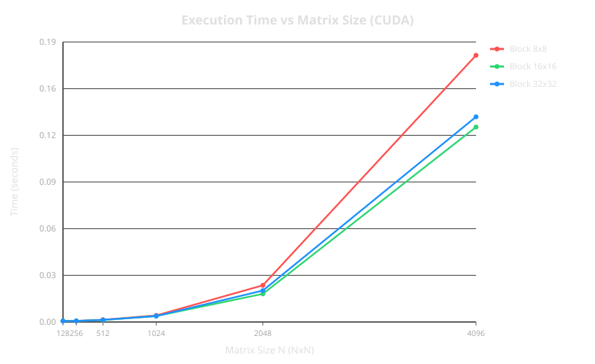
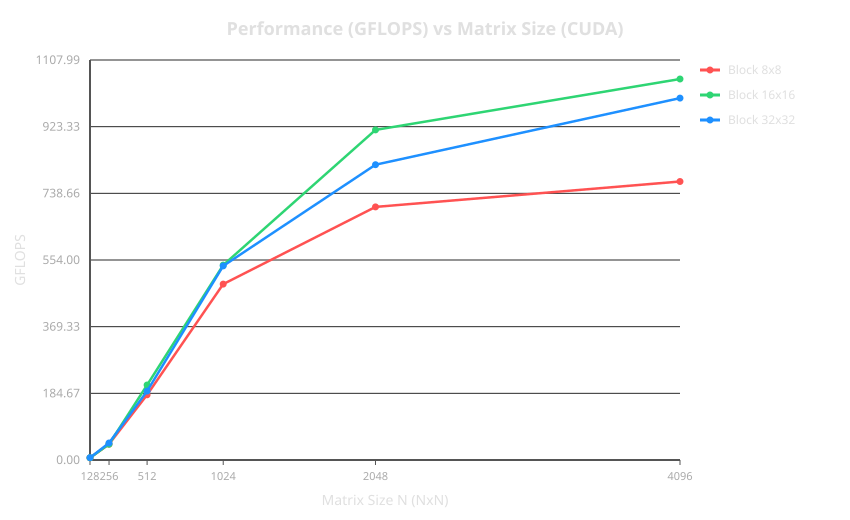
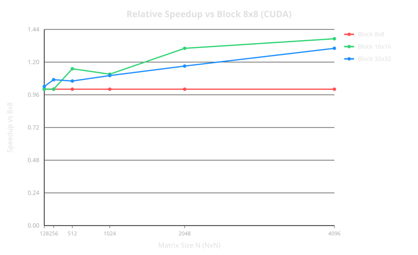

# Лабораторная работа №4: Параллельное умножение матриц с использованием NVIDIA CUDA

## 1. Цель работы и задачи

**Цель работы:** Изучить принципы программирования графических процессоров с использованием технологии NVIDIA CUDA, реализовать и оптимизировать алгоритм матричного умножения $C = A \times B$ с использованием разделяемой памяти (Shared Memory Tiling), а также исследовать влияние геометрии блока нитей на итоговую производительность.

**Задачи:**
1. Реализовать C++/CUDA программу для умножения квадратных матриц с представлением матриц в виде класса `Matrix`.
2. Разработать шаблонное CUDA-ядро `matrixMulKernelShared<TILE_SIZE>`, использующее тайлинг (Shared Memory Tiling) и синхронизацию нитей через `__syncthreads()`.
3. Провести серию бенчмарков для матриц размерностью $N \in \{128, 256, 512, 1024, 2048, 4096\}$ при размерах блока $8 \times 8$, $16 \times 16$ и $32 \times 32$.
4. Измерить чистое время выполнения операций, рассчитать производительность в GFLOPS и относительное ускорение конфигураций блоков по сравнению с базовым $8 \times 8$.
5. Выполнить верификацию результатов и проанализировать полученные метрики производительности.

---

## 2. Описание алгоритма и реализации

### 2.1. Использование Shared Memory Tiling (`main.cu`)

При наивном умножении матриц на GPU каждая нить обращается к глобальной памяти (Global Memory) $2N$ раз. Потенциал пропускной способности глобальной памяти быстро исчерпывается. 

Для оптимизации я реализовал подход **Shared Memory Tiling**:
* Исходные матрицы $A$ и $B$ разбиваются на небольшие подматрицы (тайлы) размером `TILE_SIZE` $\times$ `TILE_SIZE`.
* Нити внутри одного CUDA-блока совместно загружают соответствующие тайлы из медленной глобальной памяти в быструю разделяемую память (`__shared__`).
* Вычисления выполняются локально над тайлами в `__shared__` памяти, что сокращает число обращений к глобальной памяти в `TILE_SIZE` раз.

### 2.2. Шаблонное ядро CUDA (`matrixMulKernelShared`)

Для поддержки различных конфигураций блоков без потери производительности ядро сделано шаблонным по параметру `TILE_SIZE`:

```cpp
template <int TILE_SIZE>
__global__ void matrixMulKernelShared(const float* A, const float* B, float* C, int N) {
  // Выделение разделяемой памяти под тайлы текущего блока
  __shared__ float As[TILE_SIZE][TILE_SIZE];
  __shared__ float Bs[TILE_SIZE][TILE_SIZE];

  int bx = blockIdx.x;  int by = blockIdx.y;
  int tx = threadIdx.x;  int ty = threadIdx.y;

  int row = by * TILE_SIZE + ty;
  int col = bx * TILE_SIZE + tx;

  float sum = 0.0f;

  // Итерации по тайлам вдоль K-измерения
  for (int t = 0; t < (N + TILE_SIZE - 1) / TILE_SIZE; ++t) {
    int a_col = t * TILE_SIZE + tx;
    int b_row = t * TILE_SIZE + ty;

    // Загрузка элементов A и B в shared memory с проверкой выхода за границы
    if (row < N && a_col < N) {
      As[ty][tx] = A[row * N + a_col];
    } else {
      As[ty][tx] = 0.0f;
    }

    if (b_row < N && col < N) {
      Bs[ty][tx] = B[b_row * N + col];
    } else {
      Bs[ty][tx] = 0.0f;
    }

    // Синхронизация: гарантируем завершение загрузки тайла всеми нитями
    __syncthreads();

    // Вычисление частичного произведения внутри тайла
    for (int k = 0; k < TILE_SIZE; ++k) {
      sum += As[ty][k] * Bs[k][tx];
    }

    // Синхронизация перед загрузкой следующего тайла
    __syncthreads();
  }

  // Запись итогового значения в глобальную память
  if (row < N && col < N) {
    C[row * N + col] = sum;
  }
}
```

### 2.3. Ключевые особенности реализации
1. **Обработка границ:** Условия `if (row < N && a_col < N)` предохраняют от выхода за границы массива, если размер матрицы $N$ не кратен `TILE_SIZE`. За пределами матрицы тайлы заполняются нулями (`0.0f`), что гарантирует корректность суммирования.
2. **Синхронизация `__syncthreads()`:** Вызывается дважды на каждой итерации внешнего цикла. Первая барьерная синхронизация гарантирует, что ни одна нить не начнет перемножение до полной загрузки тайлов в `As` и `Bs`. Вторая гарантирует, что текущие тайлы не перезапишутся следующей итерацией до окончания всех вычислений.
3. **Класс `Matrix` и инкапсуляция:** Класс `Matrix` инкапсулирует выделение памяти CUDA (`cudaMalloc`), передачу данных между Host и Device (`cudaMemcpy`), динамический выбор правильного шаблона ядра по `block_size` (8, 16 или 32), а также проверку ошибок CUDA (`cudaGetLastError`).

---

## 3. Экспериментальные данные

Тестирование проводилось на графическом ускорителе **NVIDIA GeForce RTX 3060 Ti**. Измерения производились для 18 конфигураций (6 размерностей $N \times 3$ варианта блоков).

Результаты занесены в сводную таблицу:

|  $N$  | Размер блока (`Block_Size`) | Время (сек) | GFLOPS  | Ускорение относительно $8 \times 8$ | Max Diff | Статус |
| :---: | :-------------------------: | :---------: | :-----: | :---------------------------------: | :------: | :----: |
|  128  |        $8 \times 8$         |  0,000683   |  6,14   |                1,00                 | 0.00513  |   OK   |
|  128  |       $16 \times 16$        |  0,000684   |  6,13   |                1,00                 | 0.00513  |   OK   |
|  128  |       $32 \times 32$        |  0,000669   |  6,27   |                1,02                 | 0.00513  |   OK   |
|  256  |        $8 \times 8$         |  0,000765   |  43,89  |                1,00                 | 0.00537  |   OK   |
|  256  |       $16 \times 16$        |  0,000766   |  43,83  |                1,00                 | 0.00537  |   OK   |
|  256  |       $32 \times 32$        |  0,000714   |  47,00  |                1,07                 | 0.00537  |   OK   |
|  512  |        $8 \times 8$         |  0,001486   | 180,65  |                1,00                 | 0.00586  |   OK   |
|  512  |       $16 \times 16$        |  0,001292   | 207,75  |                1,15                 | 0.00586  |   OK   |
|  512  |       $32 \times 32$        |  0,001406   | 190,98  |                1,06                 | 0.00586  |   OK   |
| 1024  |        $8 \times 8$         |  0,004408   | 487,14  |                1,00                 | 0.01120  |   OK   |
| 1024  |       $16 \times 16$        |  0,003977   | 539,97  |                1,11                 | 0.01120  |   OK   |
| 1024  |       $32 \times 32$        |  0,003994   | 537,66  |                1,10                 | 0.01120  |   OK   |
| 2048  |        $8 \times 8$         |  0,024509   | 700,95  |                1,00                 | 0.01810  |   OK   |
| 2048  |       $16 \times 16$        |  0,018790   | 914,32  |                1,30                 | 0.01810  |   OK   |
| 2048  |       $32 \times 32$        |  0,021003   | 817,98  |                1,17                 | 0.01810  |   OK   |
| 4096  |        $8 \times 8$         |  0,178184   | 771,33  |                1,00                 | 0.06350  |   OK   |
| 4096  |       $16 \times 16$        |  0,130245   | 1055,23 |                1,37                 | 0.06350  |   OK   |
| 4096  |       $32 \times 32$        |  0,137111   | 1002,39 |                1,30                 | 0.06350  |   OK   |

---

## 4. Подробный анализ графиков

### 4.1. Зависимость времени выполнения от $N$ (`scripts/figures/cuda_time.svg`)



* **Малые матрицы ($N \le 256$):** Время работы алгоритма ограничено накладными расходами на вызов ядра и нахождение ресурсов GPU, составляя 0.6–0.7 мс. Влияние размера блока на этих масштабах невелико.
* **Крупные матрицы ($N = 4096$):** Время вычислений существенно расходится в зависимости от конфигурации блока. Выполнение с блоком $8 \times 8$ занимает **0.178 с**, в то время как конфигурация $16 \times 16$ справляется за **0.130 с** (быстрее на 27%).

### 4.2. Производительность в GFLOPS (`scripts/figures/cuda_gflops.svg`)



* По мере роста размера матрицы $N$ графический процессор выходит на оптимальный режим параллельной загрузки вычислительных блоков (SM).
* При $N = 4096$ и блоке $16 \times 16$ достигается **пиковая производительность в 1055.23 GFLOPS (1.055 TFLOPS)**.
* Конфигурация $32 \times 32$ также показывает близкие результаты (1002.39 GFLOPS), однако немного уступает $16 \times 16$ из-за ограничений аппаратной утилизации.

### 4.3. Относительное ускорение блоков (`scripts/figures/cuda_speedup.svg`)



* **Блок $8 \times 8$ (64 нити на блок = 2 варпа):** Показывает наиболее низкие результаты. Малое количество нитей на блок не позволяет аппаратному планировщику GPU качественно скрывать задержки (Latency Hiding) при обращении к памяти.
* **Блок $16 \times 16$ (256 нитей на блок = 8 варпов):** Является наилучшим выбором. 8 варпов в блоке дают оптимальный баланс между скрытием задержек, объемом регистрового файла и эффективным использованием shared memory. При $N=4096$ дает **ускорение 1.37x** по сравнению с $8 \times 8$.
* **Блок $32 \times 32$ (1024 нити на блок = 32 варпа):** Достигает предельного числа нитей на блок для архитектуры CUDA. Это создает высокую нагрузку на ресурсы мультипроцессора (SM) и снижает показатель Occupancy, что приводит к небольшой потере скорости по сравнению с $16 \times 16$.

---

## 5. Выводы

1. **Эффективность CUDA и Shared Memory:**
   Использование технологии CUDA совместно с оптимизацией тайлинга через разделяемую память (`__shared__`) позволило достигнуть производительности в **1055.23 GFLOPS**.
2. **Сравнение с CPU (OpenMP / MPI):**
   При аналогичных размерностях $N=4096$ оптимизированный CPU-код на многоядерном процессоре демонстрирует производительность порядка 2.5–2.7 GFLOPS. Применение GPU NVIDIA GeForce RTX 3060 Ti позволило получить прирост скорости **более чем в 380 раз**.
3. **Оптимальная геометрия блока:**
   Экспериментально доказано, что геометрия блока **$16 \times 16$ (256 нитей)** является наиболее эффективной для данной задачи. Она обеспечивает на 37% более высокую скорость вычислений, чем $8 \times 8$, и опережает предельный размер блока $32 \times 32$.
4. **Корректность вычислений:**
   Все варианты тестов прошли успешную проверку совпадения результатов (`Status: OK`).

